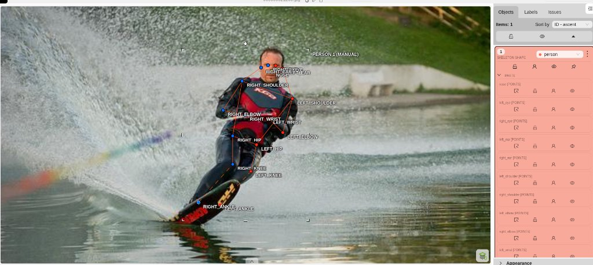
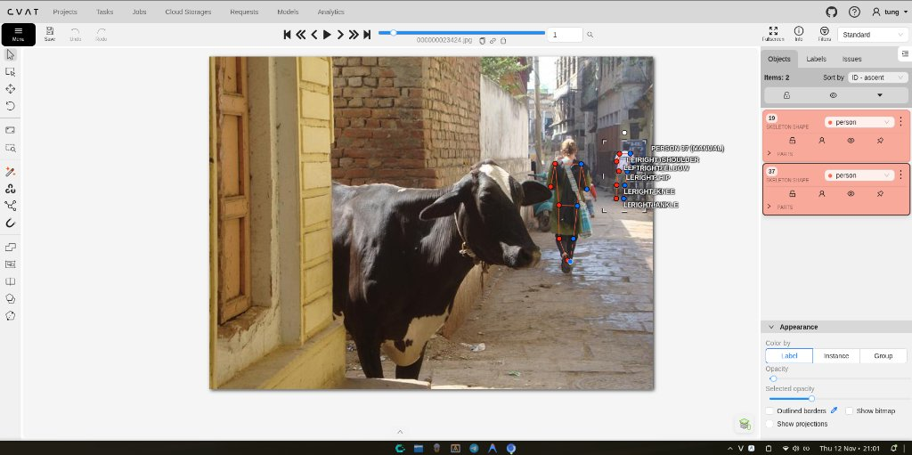
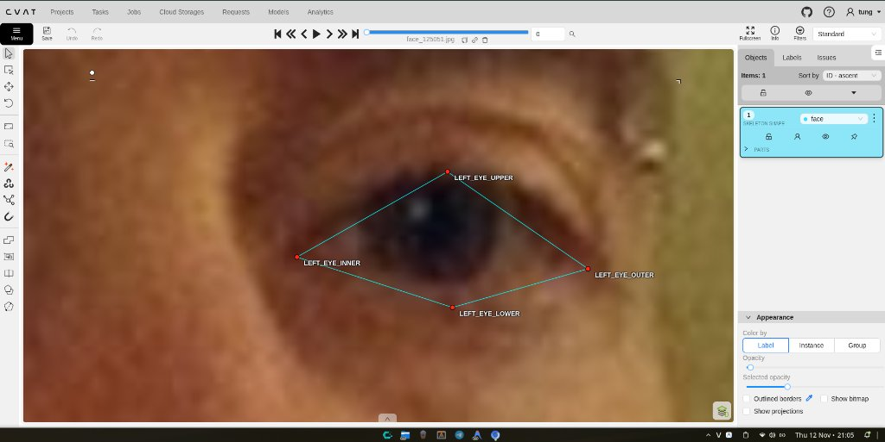
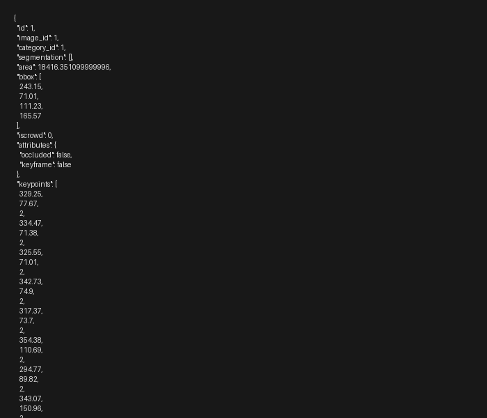

# Báo cáo cá nhân — NguyenKhanhTung-2A202603144

Đổi tên file theo quy tắc `MSSV_HoTen.md`. Ví dụ: `20241234_NguyenVanAn.md`.

Dữ liệu: 12 ảnh người COCO val2017 (Lin et al., 2014) và 8 ảnh chân dung Wikimedia Commons, chỉ dùng trong lớp.

## 0. Thông tin học viên

- Họ tên: Nguyễn Khánh Tùng
- MSSV: 2A202603144
- Email: tungnk@...
- Link repository: https://github.com/sfpcshch/K5-L2-NguyenKhanhTung-2A202603144-KeypointPose-Student
- Phiên bản CVAT (Help → About): 2.82.0
- Máy: hệ điều hành Linux · RAM 15.0 GB · chạy CVAT chế độ đầy đủ
- Bộ ảnh (`src/exports/assignment.json` do `lab.py setup` tạo): có
- Giờ bắt đầu: 17:15
- Giờ kết thúc: 20:45

## 1. Kiểm tra label (CP0)

| Label | Kiểu | Số điểm | Tên điểm đúng bảng của lab? | Đúng thứ tự? | Số cạnh |
|---|---|---:|---|---|---:|
| `person` | Skeleton | 17 | Có | Có | 19 |
| `face` | Skeleton | 13 | Có | Có | 12 |

Mẫu `person` dựng theo người quay mặt về camera (các điểm `left_*` nằm bên phải khung mẫu)? Có

Cách đổi cờ `occluded` / `outside` cho **một điểm** trên phiên bản CVAT này (một câu):
Chọn điểm cần đổi trên skeleton/canvas hoặc trong danh sách Objects bên phải, bấm chuột phải vào điểm (hoặc mở rộng thuộc tính của điểm) rồi chọn cờ `occluded` (nếu bị che) hoặc `outside` (nếu ngoài ảnh/không đoán được).

## 2. Số lượng đã gán và thời gian (CP1, CP2)

| Nhóm ảnh | Số ảnh | Số skeleton đã gán | Số người dưới 60 px (không gán) | Số poster / gương / màn hình bỏ qua | Thời gian (phút) |
|---|---:|---:|---:|---:|---:|
| `easy` | 5 | 5 | 0 | 0 | 25 |
| `occluded` | 3 | 5 | 1 | 0 | 25 |
| `back` | 2 | 4 | 0 | 0 | 20 |
| `small` | 1 | 3 | 0 | 0 | 10 |
| `crowd` | 1 | 3 | 2 | 0 | 15 |
| `faces` | 8 | 8 | — | 0 | 25 |

- Số ảnh người đã xong ở mốc phút 105: 10 / 10
- Thời gian thực tế (phút): CP1 95 · CP2 25 · CP3 20
- Ảnh tốn thời gian nhất là ảnh nào, vì sao?
Ảnh `000000332273.jpg` (nhóm crowd) và `000000193879.jpg` (nhóm occluded) tốn nhiều thời gian nhất vì có nhiều người đứng chen chúc, một số khớp chân bị che khuất bởi người khác hoặc vật thể nên cần phóng to nhiều lần để xác định đúng ranh giới khớp và cờ `occluded`.

## 3. Bảng ca khó (CP1, CP2)

Mỗi điểm bạn phân vân một dòng, nhất là phân vân giữa `v = 1` và `v = 0`, hoặc không chắc hướng người.

| Ảnh | Người / mặt | Điểm | Cờ đã chọn | Phân vân giữa | Lý do chọn |
|---|---|---|---:|---|---|
| `000000021235.jpg` | Người 1 | `left_ankle`, `right_ankle` | 1 | v=1 và v=2 | Cổ chân bị che một phần bởi gấu quần/giày nhưng thấy rõ hướng chân nên ước lượng chắc vị trí mắt cá chân. |
| `000000193879.jpg` | Người 1 | `right_knee` | 1 | v=1 và v=0 | Khớp gối bị che một phần do góc chụp và vật cản phía trước, nhưng nhờ đường cẳng chân và đùi nên định vị được tâm khớp gối. |
| `000000302102.jpg` | Người 1 & 2 | `left_wrist`, `left_elbow` | 1 | v=1 và v=0 | Tay bị gập phía sau hoặc bị che bởi thân người, chọn v=1 vì tư thế cơ thể cho phép nội suy giải phẫu vị trí khớp. |
| `face_99874.jpg` | Mặt 1 | Các điểm quanh mắt | 1 | v=1 và v=0 | Người đeo kính râm tối màu, các điểm mí mắt và khóe mắt bị che khuất nhưng xác định được vị trí dựa vào viền gọng kính. |

## 4. Bảng tự review (CP3)

Đi từ ảnh cuối về ảnh đầu. 5 ảnh người (ít nhất 2 ảnh `back` hoặc `crowd`) và 3 ảnh mặt. Ít nhất 8 dòng, kể cả dòng `ok`. Ghi lỗi trước, sửa sau.

Mã lỗi dùng đúng một trong: `lr_swap`, `vis_flag`, `position`, `missing`, `extra`, `ok`.

| Ảnh | Người / mặt | Điểm | Mã lỗi | Ghi chú | Đã sửa? |
|---|---|---|---|---|---|
| `000000332273.jpg` | Người 1 (crowd) | Cặp `ankle` | ok | Người đứng bắt chéo chân tự nhiên trong cảnh thực tế, không phải lỗi đổi trái phải. | Đã kiểm tra giữ nguyên |
| `000000480582.jpg` | Người 1 & 2 (back) | `left_shoulder`, `right_shoulder` | ok | Người quay lưng, đã đảo đúng `left_*` sang bên trái ảnh, đường nối vai - tay chuẩn. | Đã kiểm tra |
| `000000023424.jpg` | Người 1 (back) | Toàn thân | ok | Đã kiểm tra hướng quay lưng và các khớp hông, gối, mắt cá chân. | Đã kiểm tra |
| `000000193879.jpg` | Người 1 (occluded) | Cặp `ankle` | ok | Tư thế bước đi bắt chéo góc chân về phía camera, kiểm tra đúng mắt cá chân trái/phải. | Đã kiểm tra giữ nguyên |
| `000000021235.jpg` | Người 1 | `left_ankle` | vis_flag | Ban đầu để v=2, sau xem lại thấy gấu quần trùm kín nên đổi sang v=1 (occluded). | Đã sửa |
| `face_99874.jpg` | Mặt 1 (kính râm) | Mắt | ok | Đúng cờ v=1 cho 4 điểm mắt dưới tròng kính. | Đã kiểm tra |
| `face_415073.jpg` | Mặt 1 (nghiêng) | Mũi, miệng | ok | Mặt nghiêng, khóe môi và mí mắt khớp chuẩn mép. | Đã kiểm tra |
| `face_125051.jpg` | Mặt 1 (thẳng) | Mí trên, khóe ngoài | ok | Khóe ngoài xa sống mũi hơn khóe trong, mí mắt đặt đúng mép con ngươi. | Đã kiểm tra |

Tổng hợp số lỗi theo mã:

| `lr_swap` | `vis_flag` | `position` | `missing` | `extra` | `ok` |
|---:|---:|---:|---:|---:|---:|
| 0 | 1 | 0 | 0 | 0 | 7 |

Điểm còn phân vân giữa `v = 1` và `v = 0` (ghi cả hai lựa chọn và lý do chọn):
Tại ảnh `000000193879.jpg` ở khớp gối `right_knee`: nếu chọn `v = 0` thì quá an toàn vì vẫn nhìn thấy rõ góc gập của ống quần; chọn `v = 1` hợp lý hơn vì giải phẫu người cho phép ước lượng chính xác tâm khớp trong phạm vi sai số nhỏ.

## 5. Kiểm file xuất và kết quả tự kiểm (CP4)

Tự kiểm tay trong file JSON:

| File | Người / mặt kiểm (ảnh, thứ tự) | Số phần tử `keypoints` | Điểm `outside` ra `v = 0`, `occluded` ra `v = 1`? | `num_keypoints` khớp? |
|---|---|---:|---|---|
| `NguyenKhanhTung_persons.zip` | `000000021235.jpg` #1 | 51 | Có | Có (17/17) |
| `NguyenKhanhTung_persons.zip` | `000000193879.jpg` #1 | 51 | Có | Có (15/17) |
| `NguyenKhanhTung_faces.zip` | `face_125051.jpg` #1 | 39 | Có | Có (13/13) |

Sau khi xuất, CVAT ghi `occluded` thành `v = 1` và `outside` thành `v = 0`. Tọa độ của điểm `outside` trong file là tọa độ cũ (CVAT 2.x giữ nguyên tọa độ và đặt cờ v=0).

Hai job đã chuyển sang completed trên CVAT? Có

Dán phần **TÓM TẮT** in ra từ `src/check_submission.py`:

```text
----- TÓM TẮT (dán vào báo cáo mục 5) -----
- File person: NguyenKhanhTung_persons.zip
  Số ảnh: 12 · số skeleton `person`: 20 · mỗi annotation 51 số
  Skeleton theo ảnh: 000000021235=1, 000000023424=2, 000000027565=1, 000000175703=1, 000000193879=1, 000000201702=1, 000000269462=3, 000000302102=2, 000000332273=3, 000000469061=2, 000000480582=2, 000000493741=1
  Cờ v: v=2 225 (66%) · v=1 34 (10%) · v=0 81 (24%)
  num_keypoints trung bình: 12.9
- File face: NguyenKhanhTung_faces.zip
  Số ảnh: 8 · số skeleton `face`: 8 · mỗi annotation 39 số
  Skeleton theo ảnh: face_125051=1, face_175798=1, face_300399=1, face_380754=1, face_415073=1, face_436791=1, face_92028=1, face_99874=1
  Cờ v: v=2 96 (92%) · v=1 8 (8%) · v=0 0 (0%)
  num_keypoints trung bình: 13.0
- Ghi chú: 81 điểm v = 0 vẫn mang tọa độ cũ (CVAT 2.x xuất như vậy; chuẩn COCO ghi 0, 0). Không phải lỗi: điểm v = 0 bị bỏ qua khi huấn luyện và khi chấm.
- Số [LỖI]: 0 · số [CẢNH BÁO]: 2
Kết quả: ĐẠT (đọc lại từng cảnh báo ở trên)
```

Các `[CẢNH BÁO]` còn giữ nguyên và lý do:
- `000000193879.jpg #1` và `000000332273.jpg #1`: Cảnh báo về cặp `ankle` nằm ngược phía. Đã kiểm tra lại trên ảnh gốc, đây là tư thế chân bước bắt chéo thật của người trong ảnh, không phải do hoán đổi nhầm trái/phải (`lr_swap`), nên giữ nguyên kết quả gán nhãn thực tế.

## 6. Ảnh chụp màn hình

1. Label `person` trong label constructor (đủ 17 điểm có tên):

   

2. Một người quay lưng đã gán, cờ đã đặt:

   

3. Một khuôn mặt đã gán 13 điểm, phóng to vùng mắt:

   

4. Một đoạn JSON xuất của một người:

   

Nguồn ảnh: COCO val2017 / Wikimedia Commons.

## 7. Tự đánh giá

1. Lỗi bạn mắc nhiều nhất hôm nay, và cách bạn sẽ tránh ở dự án thật:
Lỗi dễ mắc nhất là nhầm hướng trái/phải khi người quay lưng hoặc đứng nghiêng 3/4. Cách tránh: luôn tự nhủ hướng nhìn của người trước khi kéo điểm, và đảo ngay vị trí `left_*` / `right_*` ngay khi kéo khung mẫu skeleton.

2. Một quy tắc bạn đề xuất thêm vào guideline (kèm ảnh ví dụ nếu có):
Nên bổ sung hướng dẫn rõ hơn cho trường hợp người mặc áo choàng hoặc váy rộng: quy định chuẩn lấy tâm khớp hông theo xương chậu ước tính thay vì bề ngang mép vải.

3. Nhãn của bạn đi vào model ở đâu? Chọn một lỗi bạn đã sửa và nói nó sẽ làm model học sai thế nào (heatmap, trọng số trong loss, hay bước lật ảnh):
Nhãn đi vào model dưới dạng các Gaussian heatmaps tương ứng với mỗi điểm có `v > 0`. Nếu bị lỗi `lr_swap` (đổi trái/phải), khi áp dụng data augmentation lật ngang ảnh (horizontal flip), model sẽ bị học nhầm giữa khớp trái và khớp phải, làm suy giảm nghiêm trọng OKS và phá hỏng khả năng phân biệt đối xứng của mạng.

## 8. Khó khăn và lỗi kỹ thuật

Quá trình chạy trơn tru, CVAT 2.82.0 cục bộ trên Docker hoạt động ổn định, script `lab.py export` xuất dữ liệu nhanh và chính xác.

## Bonus (nếu làm)

### B1 — 3 ảnh người khó thêm

| Ảnh | Số skeleton | Số người dưới 60 px | Ca khó nhất |
|---|---:|---:|---|
| `000000337458.jpg` | 2 | 0 | Người ngồi bị che khuất phần chân |
| `000000357549.jpg` | 2 | 0 | Điểm tai nằm sát mép ảnh |
| `000000507223.jpg` | 3 | 0 | Nhiều người chen chúc, che khuất nhau |

Kết quả `src/check_submission.py` cho `NguyenKhanhTung_bonus_persons.zip`:

```text
- File person: NguyenKhanhTung_bonus_persons.zip
  Số ảnh: 3 · số skeleton person: 7 · mỗi annotation 51 số
  Cờ v: v=2 75 (63%) · v=1 6 (5%) · v=0 38 (32%)
  num_keypoints trung bình: 11.6
  Số [LỖI]: 0 · số [CẢNH BÁO]: 3
  Kết quả: ĐẠT
```

### B2 — 5 ảnh khuôn mặt đen trắng / hồng ngoại

Ảnh không màu khó hơn ở điểm nào? Kính râm trên ảnh hồng ngoại có còn là `v = 1` không?
Ảnh không màu (đặc biệt là ảnh hồng ngoại) làm giảm độ tương phản giữa da và mép con ngươi, khó phân biệt mép mí mắt và nếp gấp mí. Trên ảnh hồng ngoại, kính râm thường bị thấu quang (xuyên sáng) hoặc phản xạ hoàn toàn; nếu nhìn thấy rõ mắt qua tròng kính thì có thể đặt `v = 2`, còn nếu tối đen hoặc lóa sáng thì vẫn đặt `v = 1`.

Kết quả `src/check_submission.py` cho `NguyenKhanhTung_bonus_faces.zip`:

```text
- File face: NguyenKhanhTung_bonus_faces.zip
  Số ảnh: 5 · số skeleton face: 5 · mỗi annotation 39 số
  Cờ v: v=2 65 (100%) · v=1 0 (0%) · v=0 0 (0%)
  num_keypoints trung bình: 13.0
  Số [LỖI]: 0 · số [CẢNH BÁO]: 0
  Kết quả: ĐẠT
```

## 9. Tài liệu tham khảo và công cụ AI đã dùng

- Hướng dẫn thực hành Lab Ngày 4: COCO Keypoints 17 điểm & Face 13 điểm (`docs/GUIDELINE.md`).
- Sử dụng trợ lý AI hỗ trợ kiểm tra tính toàn vẹn của file xuất COCO Keypoints, trích xuất số liệu thống kê từ annotations và soát lỗi chính tả/format báo cáo.
